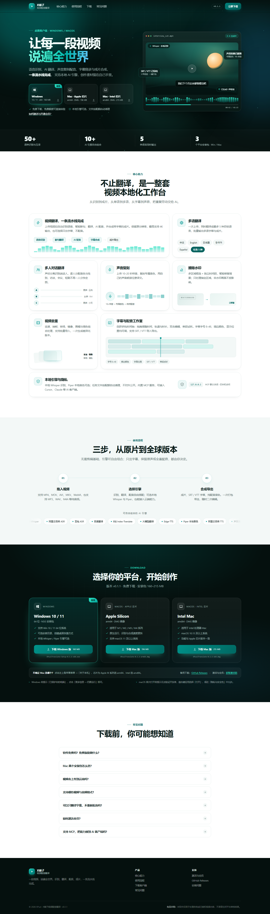

# video-translate
视频翻译 视频配音工具https://video-translate.xpuzi.com
https://video-translate.xpuzi.com/

不止翻译，是一整套
视频本地化工作台
从识别到成片，从单语到多语，从字幕到声音，把重复劳动交给 AI。

视频翻译，一条流水线完成
上传视频后自动识别语音、智能断句、翻译、AI 配音，并合成带字幕的成片。保留原分辨率，最高支持 4K 输出，也可选择只出字幕、不配音。

多人对话翻译
声纹分离识别说话人，逐人分配音色与性别，访谈、会议、短剧不再一人分饰全部。

声音复刻
上传 10–20 秒样音，复刻专属音色，用自己的声音朗读任意译文。

擦除水印
多区域框选 + 独立时间段，智能修复背景；只处理指定区域，非水印画面不受影响。

视频去重
变速、抽帧、转场、镜像、画幅与调色组合处理，支持批量导入，一次生成差异化版本。

字幕与配音工作室
自研多轨时间轴：拖拽调整时间、轨道与时长，双击编辑、单段试听。字幕字号 8–48、描边颜色、显示位置均可调，支持 SRT / VTT 导入导出。

本地引擎与隐私
本地 Whisper 识别、Piper 本地音色可选；任务文件按配额自动清理、不对外公开。内置 MCP 服务，可接入 Cursor、Claude 等 AI 客户端。


  <a href="https://github.com/ckc125/video-translate/releases"></a>


## 下载与安装

桌面客户端在 [Releases](https://github.com/ckc125/video-translate/releases) 页面下载。

### 选择版本

| 平台 | 文件 | 说明 |
| --- | --- | --- |
| macOS Intel | `X-Translate-0.1.3-x64.dmg` | Intel 芯片 Mac 用这个 |
| macOS Apple Silicon | `X-Translate-0.1.3-arm64.dmg` | M1 / M2 / M3 / M4 芯片 Mac 用这个（x64 版需另装 Rosetta 2） |
| Windows | `X-Translate-Setup-0.1.3-x64.exe` | 安装版 |

### ⚠️ macOS 首次运行（重要）

当前版本采用 ad-hoc 签名、尚未经过 Apple 公证（notarization）。从浏览器下载的 App 会被 macOS 加上隔离属性，**首次双击会被 Gatekeeper 拦截**，提示：

> 无法打开「X铺子·视频配音翻译」，因为 Apple 无法检查其是否包含恶意软件。

这**不是 App 损坏**，按以下任一方式放行一次即可，之后双击都能正常运行：

1. 在「应用程序」里**右键** App →「打开」→ 弹窗里再点「打开」；
2. 或打开「系统设置 → 隐私与安全性」，拉到底部「已阻止打开」，点「仍要打开」；
3. 或在终端执行：

```bash
xattr -dr com.apple.quarantine "/Applications/X铺子·视频配音翻译.app"
```

> 提示：若在 Apple Silicon 上安装了 x64 版本，系统会提示安装 Rosetta 2，按提示安装即可；更推荐直接使用 arm64 版本。

### Windows

直接运行 `X-Translate-Setup-0.1.3-x64.exe`，按向导安装即可。
